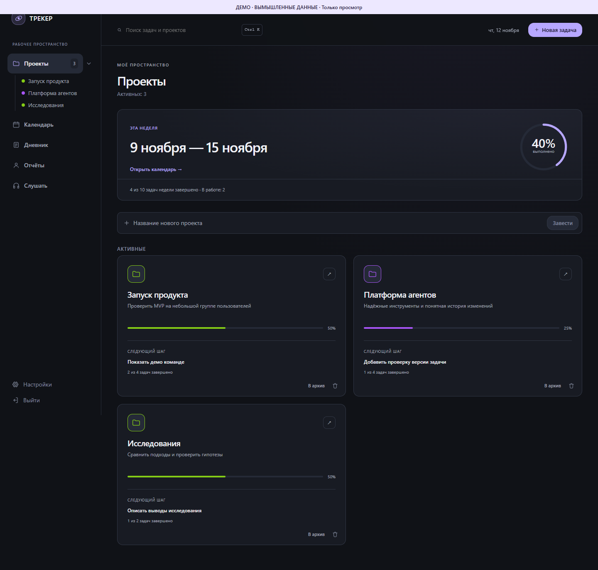
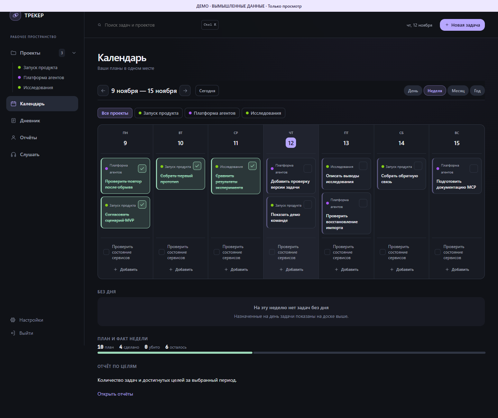
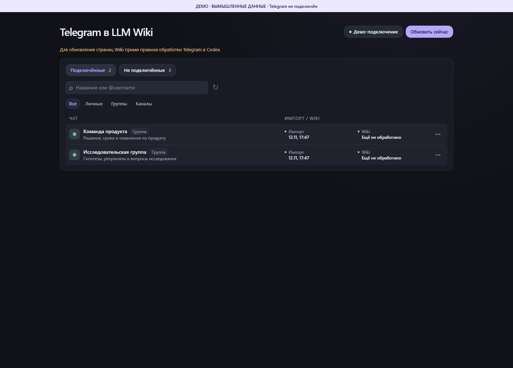

# LLM Wiki · Codex, Skills и MCP

Я веду личную базу знаний в Obsidian и работаю с ней через Codex. Агент читает источники и обновляет связанные страницы по правилам проекта. Через MCP он работает с моим трекером задач, читает Telegram и расшифровывает локальные записи.

## Где смотреть

| Компонент | Рабочие файлы |
| --- | --- |
| Инструкции проекта | [AGENTS.md](AGENTS.md), [правила Wiki](Правила%20LLM%20Wiki.md) |
| Поиск и обновление Wiki | [wiki-query](.agents/skills/wiki-query/SKILL.md), [wiki-ingest](.agents/skills/wiki-ingest/SKILL.md), [wiki-edit](.agents/skills/wiki-edit/SKILL.md) |
| Обработка источников из сервисов | [wiki-tracker-ingest](.agents/skills/wiki-tracker-ingest/SKILL.md), [wiki-telegram-ingest](.agents/skills/wiki-telegram-ingest/SKILL.md) |
| MCP трекера | [схемы инструментов](service/tracker/src/server/mcp/catalog.ts), [HTTP-сервер и вызов API](service/tracker/src/server/mcp/server.ts#L34), [проверка версии и повтора команды на стороне API](service/tracker/src/server/api/wiki.ts#L44), [доставка истории](service/tracker/etc/wiki-sync.ts) |
| MCP Telegram | [сервер и инструменты](service/telegram-wiki/src/server/mcp.ts#L42), [подготовка и отправка](service/telegram-wiki/src/server/operations.ts#L16), [импорт](service/telegram-wiki/src/server/importer.ts#L67), [состояние обработки Wiki](service/telegram-wiki/src/server/processing.ts#L39) |
| MCP расшифровки | [stdio-сервер](.codex/transcription/server.mjs), [выбор Groq или Deepgram](.codex/transcription/core.mjs#L19) |

Трекер принимает изменение с версией объекта и `operationId`. При конфликте агент заново читает объект. Если ответ потерялся, он повторяет исходный запрос с тем же идентификатором. Сервер проверяет параметры повтора.

В Telegram чтение, импорт, подготовка отправки и отправка — отдельные операции. Агент показывает адресата и текст перед отправкой, а сервер сверяет их с подготовленной операцией. Импорт сохраняет исходные порции. Скилл берёт их в обработку после принятия его версии владельцем Wiki.

## Что вошло в публикацию

`AGENTS.md`, пять скиллов и MCP взяты из рабочего проекта. В публичной копии заменены локальные пути, адрес развёрнутого трекера и пути к настройкам. [Пример конфига Codex](.codex/config.example.toml) показывает подключения всех трёх MCP. Ключи, Telegram-сессия, база задач, переписка, содержимое Wiki и состояние импорта хранятся вне этого репозитория.

Для трекера здесь опубликованы MCP, код доставки истории и относящиеся к ним части Wiki API и PostgreSQL. Полное приложение трекера работает отдельно. Telegram-компонент включает приложение и локальный шлюз. Python-код шлюза основан на [chigwell/telegram-mcp](https://github.com/chigwell/telegram-mcp) и опубликован с его лицензией. Мои изменения в шлюзе описаны в [документации Telegram-компонента](service/telegram-wiki/SECURITY.md).

## Скриншоты

### Трекер задач





### Telegram → LLM Wiki



## Проверки

Нужен Node.js 24+. Тесты трекера и Telegram поднимают локальные тестовые сервисы и используют временные файлы. Для них не нужны логин, API-ключи и личная Wiki.

```sh
npx --yes pnpm@11.7.0 install --frozen-lockfile
npx --yes pnpm@11.7.0 -r test
npx --yes pnpm@11.7.0 --filter telegram-wiki typecheck
```

Отдельно можно проверить логику выбора сервиса расшифровки без обращения к API.

```sh
cd .codex/transcription
npm ci
npm test
```
